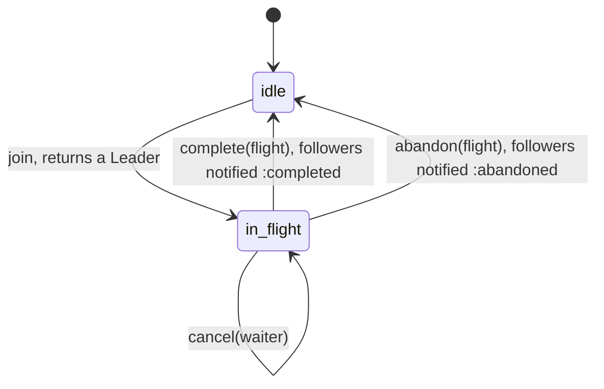
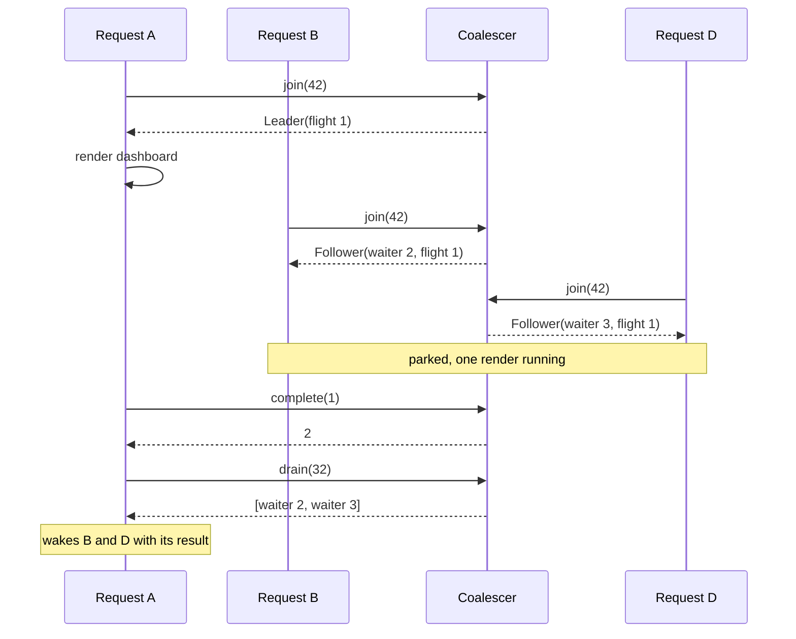

# CoalesceMachines

> Four hundred requests for the same thing is one request and three hundred ninety-nine people waiting. 🛰️

An in-flight registry for Ruby. Before you compute something expensive, you join its key. The first caller is told to lead: go compute it. Everyone who joins while that's still running is told to follow: wait, you'll be woken. When the leader finishes, the registry hands you the list of followers to wake. It runs nothing and stores no results. It only keeps track of who's computing, who's waiting, and whom to notify.

This is an initial, unstable API. It's a policy core, not a runtime: there are no threads, promises, or timeouts in here.

## Quick Start

```bash
gem 'coalesce_machines'
```

```ruby
flights = CoalesceMachines::Coalescer.new
results = {}   # flight id => value, yours to keep
parked  = {}   # waiter id => whatever is waiting, yours to wake

case (role = flights.join(key))
when CoalesceMachines::Leader
  results[role.flight] = render_dashboard(key)
  flights.complete(role.flight)
when CoalesceMachines::Follower
  parked[role.waiter] = queue
else
  raise "coalescer refused #{key}: #{role}"   # :flights_full, :waiters_full
end

flights.drain(32).each do |note|
  parked.delete(note.waiter).push(results[note.flight])
end
```

Two coalescers built with `Coalescer.new` are both scope zero and issue the same ids, so an id handed to the wrong one can name a live flight there. Run more than one? Give each its own scope:

```ruby
dashboards = CoalesceMachines::Coalescer.with_scope(1)
reports    = CoalesceMachines::Coalescer.with_scope(2)
dashboards.join(42).flight == reports.join(42).flight   # => false
```

One coalescer, five verbs: `join`, `complete`, `abandon`, `cancel`, `drain` (and `poll`, a drain of one). Keys and ids are Integers.

## A Message to the Resistance

So the cache entry for the homepage expired. It takes two seconds to rebuild. In those two seconds, four hundred requests arrived, each looked in the cache, each found nothing, and each started the same two-second query. Your database is now doing the same work four hundred times, which takes rather longer than two seconds, during which more requests arrive.

You know the fix. "Just put a mutex around it." So you do, and now four hundred threads queue on the mutex and run the query one after another, because each of them still thinks it has to. So you add a check-again-after-locking. Then the leader raises, and three hundred ninety-nine waiters hang, or all get the exception, or all retry at once. Then a client disconnects while waiting and its slot is never given back.

The piece you keep rebuilding is a small table: this key has a computation in the air, these callers are waiting on it, and when it lands, here's who to tell. That table is this gem.

## Chapter 1: Stardate 2026.316, the AMS Fitzpatrick

> **AMS Fitzpatrick**, NCC-4229, *Fitzpatrick*-class rendezvous tender.
> One shuttle goes down to the surface. Everyone else holds formation.

The tender doesn't fly the mission. It keeps the rendezvous board. The first ship to ask for a survey of a given moon is sent to do it. Every ship that asks for the same moon while that one is still out is assigned a holding position and a callsign. When the survey ship reports back, the tender reads out the callsigns. Then it wipes that moon off the board, because a survey from an hour ago is somebody else's department.

On a bridge somewhere, a cadet volunteers:

```ruby
def dashboard(key)
  Rails.cache.fetch(key) { render_dashboard(key) }
end
```

"That," says the tender's flight controller, "sends the whole fleet to the same moon."

## The Flight Plan

Each key the coalescer knows about is in flight or it isn't:



And the afternoon three requests wanted dashboard 42 at once:



## How the Coalescer Works

### Join

```ruby
flights = CoalesceMachines::Coalescer.new

leader = flights.join(42)
leader.class       # => CoalesceMachines::Leader
leader.flight   # => 1, the flight id you settle
```

A `Leader` means nobody was computing this key and now you are. Join again while it's still in flight and you get a `Follower`:

```ruby
follower = flights.join(42)
follower.class       # => CoalesceMachines::Follower
follower.waiter   # => 2
follower.flight   # => 1, the same flight
```

`waiter` is the notification id. Park whatever is waiting under it. `Leader` and `Follower` carry ids only; you already hold the key you joined with.

### Complete

```ruby
flights.complete(leader.flight)   # => 1, one follower to notify
flights.complete(leader.flight)   # => :stale, already settled
flights.join(42).class               # => CoalesceMachines::Leader
```

`complete` returns how many followers were queued for notification and takes the key off the board. The coalescer doesn't remember that 42 was ever computed. The next `join(42)` leads a new flight with a new id, and the old id stays `:stale` forever.

### Drain

```ruby
notes = flights.drain(32)
notes.first
# => #<data CoalesceMachines::Notification waiter=2, flight=1, key=42, outcome=:completed>
flights.drain(32)   # => []
```

`drain(max)` hands back at most `max` notifications (`max` an Integer in `0..=WAITER_CAPACITY`, more than can ever be queued; anything above raises `RangeError`), oldest first, and keeps the rest for the next call. Flights are drained in the order they settled, and followers of one flight in the order they joined. Each notification is delivered once.

`poll` takes just the oldest one, or `nil` when nothing is queued:

```ruby
flights.poll   # => a Notification, or nil
```

### Abandon

A leader that failed and has nothing to share gives the key back:

```ruby
flights = CoalesceMachines::Coalescer.new
leader = flights.join(7)
follower = flights.join(7)

flights.abandon(leader.flight)   # => 1
flights.drain(8).first.outcome      # => :abandoned
flights.join(7).class               # => CoalesceMachines::Leader
```

Followers of an abandoned flight are notified with `:abandoned`. The ones that still want the value `join` again, and the first one back leads. If you'd rather every follower see the leader's exception, call `complete` and store the exception as the result. That's your policy, not the coalescer's.

### Cancel

A follower that stopped caring, say its client hung up, withdraws:

```ruby
flights = CoalesceMachines::Coalescer.new
leader = flights.join(7)
follower = flights.join(7)

flights.cancel(follower.waiter)     # => :cancelled
flights.cancel(follower.waiter)     # => :stale
flights.followers(leader.flight)    # => 0
flights.complete(leader.flight)     # => 0, nobody to notify
```

Cancel also works after the flight settled, as long as the notification hasn't been drained yet. Either way, once you get `:cancelled`, that waiter id will never come out of `drain`.

The flight keeps going when its last follower leaves. If you want to stop a computation nobody is waiting for, `followers(flight)` tells you when that's true.

### Capacity

The coalescer holds 64 flights and 256 waiters. A waiter slot is in use while its follower waits, and stays in use until its notification is drained:

```ruby
flights = CoalesceMachines::Coalescer.new
CoalesceMachines::Coalescer::FLIGHT_CAPACITY   # => 64
CoalesceMachines::Coalescer::WAITER_CAPACITY   # => 256

leaders = 64.times.map { |key| flights.join(key) }
flights.join(64)                               # => :flights_full

256.times { flights.join(0) }
flights.join(0)                                # => :waiters_full

flights.complete(leaders.first.flight)      # => 256
flights.join(1)                                # => :waiters_full, nothing drained yet
flights.drain(1)
flights.join(1).class                          # => CoalesceMachines::Follower
```

Nothing is evicted to make room. On `:flights_full` or `:waiters_full`, compute it yourself uncoalesced, shed the request, or drain and try again.

### Looking around

```ruby
flights.flight(42)      # => flight id, or nil when 42 isn't in flight
flights.followers(id)   # => followers still waiting, or nil when id isn't in flight
flights.in_flight       # => flights not yet settled
flights.waiting         # => followers waiting, across all keys
flights.pending         # => notifications queued and not yet drained
```

## The Rules of the Tender

- **Keys and ids are Integers** in `0..2**64-1`. Floats, nil, and strings raise `TypeError`. Out of range raises `RangeError`, and so does an id whose sequence number (the low 48 bits) is zero: no coalescer issues one, so `complete(0)` is malformed input, not `:stale`.
- **Values are valid or do not exist.** `Leader`, `Follower` and `Notification` built by hand are held to what the coalescer could have answered, by the core's own constructors: ids with a positive sequence number, a follower's waiter of its flight's scope and issued after it, an outcome of `:completed` or `:abandoned`. A wrong type raises `TypeError`, anything else out of line `RangeError`. The three classes are sealed (subclassing raises `TypeError`, `allocate` is undefined); sealing stops accidents, not reflection, but the coalescer reads none of them back, so a forged one reaches nothing.
- **A raise loses nothing.** Everything that can raise (argument conversion, a `drain(max)` above capacity) is settled before the coalescer changes; a call that raises joined, settled and drained nothing. The `Leader`, `Follower` and `Notification` it answers with are built natively from what the coalescer returned, without calling `new` or any Ruby code, on a copy of the coalescer that is kept only once the answer exists. If your keys are strings, hash them yourself, and know that two keys with the same hash share a flight.
- **Scopes: ids belong to the coalescer that issued them.** Ids are plain Integers, so two coalescers in the same scope issue the same ones, and an id handed to the wrong coalescer can name a live flight or waiter there. If you run more than one, give each its own scope: `Coalescer.with_scope(3)`, any Integer in `0..65_535`. `Coalescer.new` is scope zero and counts 1, 2, 3. The scope rides in the top 16 bits of every id, above a 48-bit sequence, and an id from another scope is always `:stale`. The coalescer can't pick a scope for you. `CoalesceMachines.scope_of(id)` reads the scope back, so you can route an id to the coalescer that issued it. It is the only layout helper the gem has: the layout belongs to the Rust crate `periscope-machines`, which has no gem. After `2**48 - 1` ids `join` answers `:exhausted`. A flight id is not a waiter id.
- **One sequence, and `reserve`.** Flight ids and waiter ids come from the same counter, so no two ids of one coalescer are ever equal. `reserve` takes the next number of that sequence for a handle of your own, a lease or a ticket you keep in your own table next to the coalescer: it is never a flight or a waiter (`:stale` or `nil` from every method, forever), never issued again, and `:exhausted` once the sequence is spent. `owns?(id)` says whether this coalescer issued an id, live or not; `issued` and `remaining` count the sequence.
- **Restarts: resume the sequence, or take a new scope.** A new coalescer counts from one again, so an id that outlived a restart could name a new flight. Either save `issued` and build the replacement with `Coalescer.resumed(scope, issued)`, which has nothing in flight and carries on after the saved count (`RangeError` if `issued` is more than `2**48 - 1`), or give each incarnation a scope it never had before.
- **Ids are never reused.** A settled flight, a cancelled waiter, and a drained notification are `:stale` from then on. That includes repeats: a second `complete`, `abandon`, or `cancel` is `:stale`, because the coalescer keeps nothing about how a flight or waiter ended.
- **Refusals don't raise and don't change anything.** `:flights_full`, `:waiters_full`, `:exhausted`, and `:stale` are answers. Only malformed input raises: a scope that isn't an Integer raises `TypeError`, one outside `0..65_535` raises `RangeError`, and so on for every argument (see above).
- **Every answer, by method.**

  | Method | Honoured | Refused |
  | --- | --- | --- |
  | `join(key)` | a `Leader` or a `Follower` | `:flights_full`, `:waiters_full`, `:exhausted` |
  | `complete(flight)` | followers queued for notification (Integer) | `:stale` |
  | `abandon(flight)` | followers queued for notification (Integer) | `:stale` |
  | `cancel(waiter)` | `:cancelled` | `:stale` |
  | `reserve` | the next id of the sequence (Integer) | `:exhausted` |
  | `poll` | the oldest queued `Notification`, `nil` when nothing is queued | never refuses |
  | `drain(max)` | an Array of at most `max` `Notification`, `[]` when nothing is queued; `RangeError` for `max` above `WAITER_CAPACITY` | never refuses |

  Every refusal has its own symbol; there is no catch-all. No answer records a clock: the coalescer takes no time at all, so nothing it answers depends on when you ask.
- **Whoever holds the flight id can settle it.** Give it to the leader and nobody else.
- **Frozen means frozen.** `freeze` the coalescer and `join`, `complete`, `abandon`, `cancel`, `reserve`, `poll`, and `drain` all raise `FrozenError`.
- **Not thread-safe.** Wrap it in your own mutex if several threads share one. Hold the mutex for the call, not for the computation.

## What You Think You're Doing vs Reality

### You Think: "The cache handles concurrent misses."
### Reality: The cache handles concurrent hits.

A cache answers "do I have it?" A miss means no, for everyone who asks until someone writes it. Four hundred misses are four hundred computations. Coalescing covers the gap between the first miss and the write.

### You Think: "This is deduplication."
### Reality: Deduplication remembers. This forgets.

[dedup_machines](https://github.com/seuros/dedup_machines) answers "has this already been done?" and keeps saying yes so the effect isn't repeated. The coalescer answers "is this being done right now?" and the moment the flight settles, the answer is no. The second request after completion computes again. If that's not what you want, you want a cache or a dedup ledger behind it.

### You Think: "If the leader dies, the followers will find out."
### Reality: Nobody finds out until you say so.

There's no clock in here. A leader that crashes without calling `complete` or `abandon` holds its key, and its followers, until you call `abandon` for it. Put the leader's work in an `ensure`, or run your own deadline and abandon on expiry.

## What's Yours

The computation, and the thread or fiber it runs on. The result, and how long you keep it: store it under the flight id and drop it once the followers are woken. The parking: a queue, a promise, a condition variable, keyed by the waiter id. The wake-up: call `drain` after you settle, and keep calling until it comes back empty. Timeouts for leaders that never land. Locking, if more than one thread touches the coalescer. And the keys: what counts as "the same request" is decided by the Integer you pass in.

The coalescer lives in your process and coordinates nothing across processes. Two app servers will each fly their own.

## License

MIT License. See [LICENSE.txt](LICENSE.txt) for details.

**Remember: the stampede isn't four hundred requests. It's four hundred computations.**
